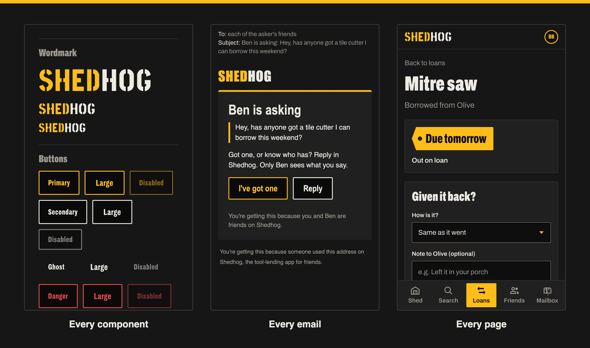
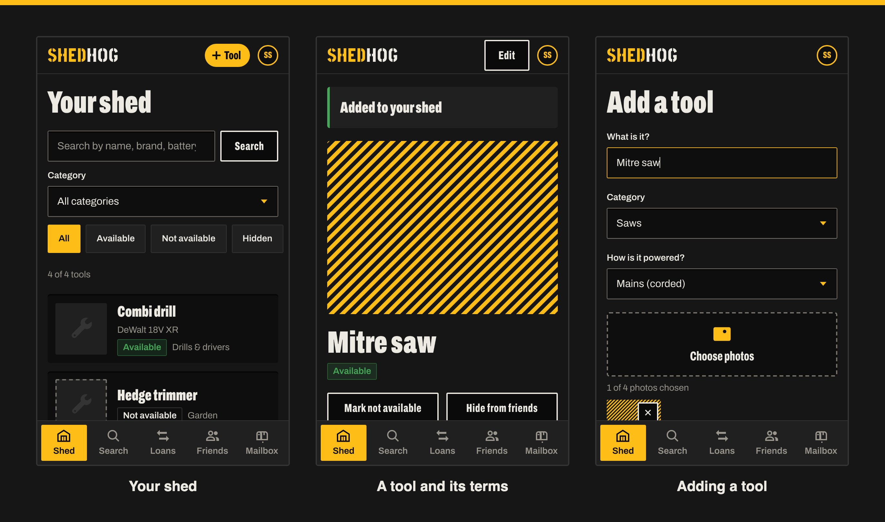
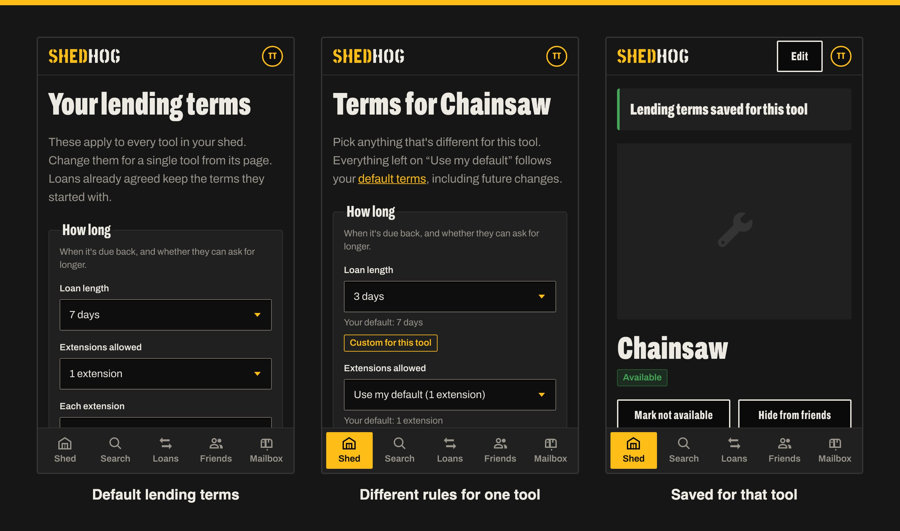
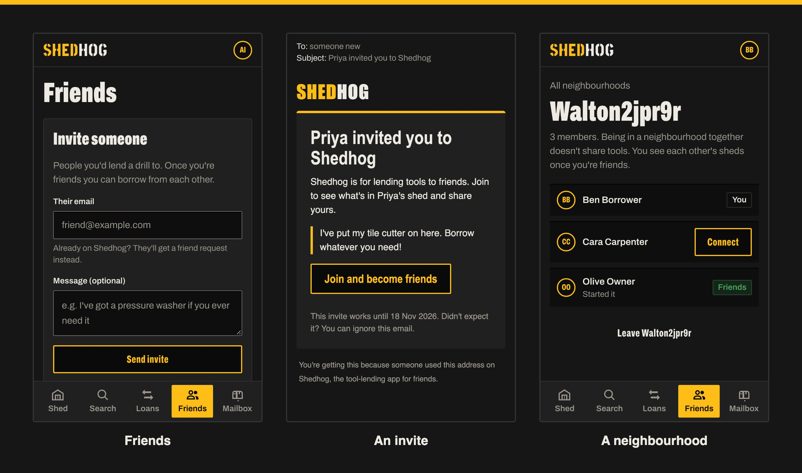
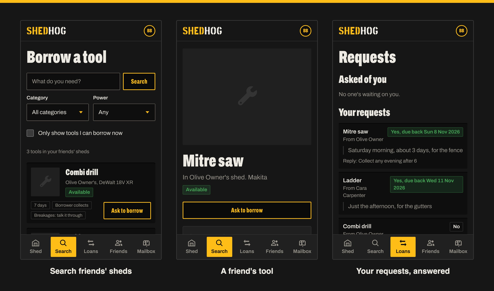
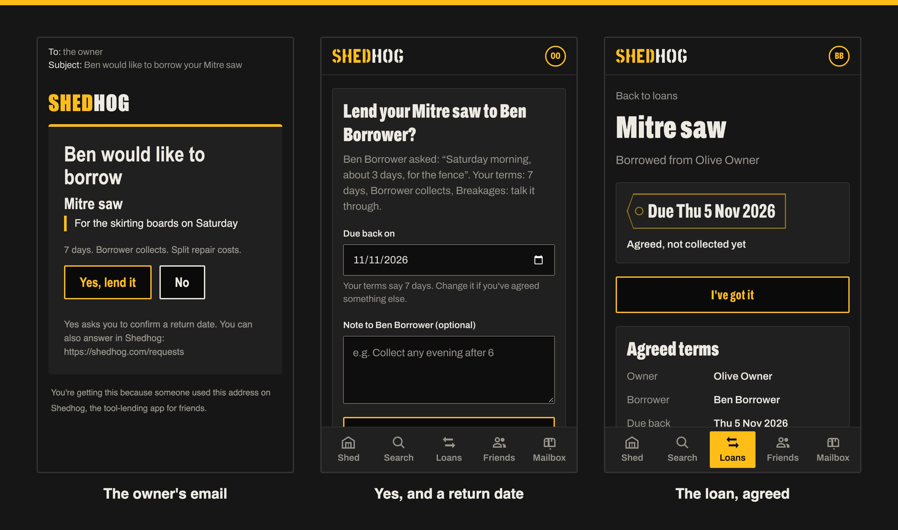
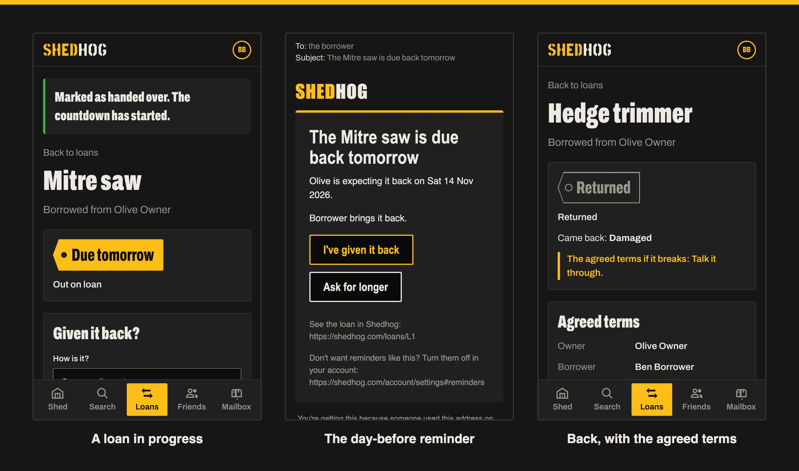
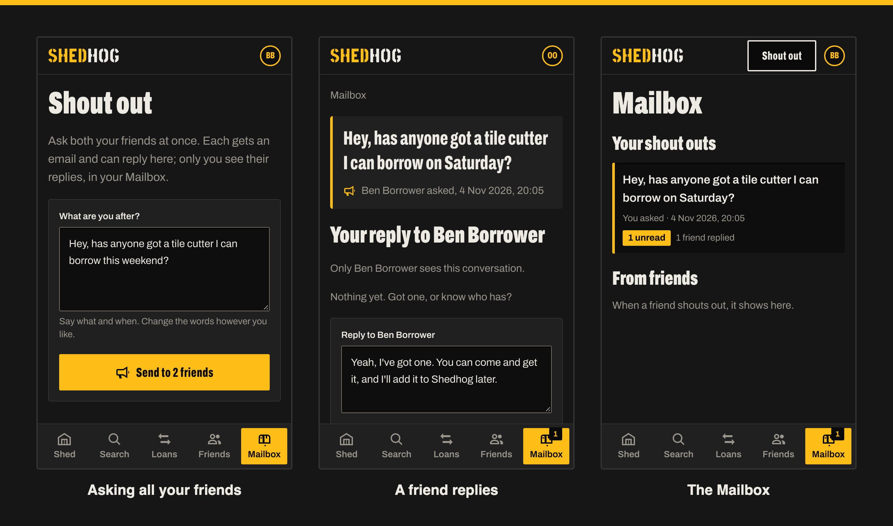

<aside aria-labelledby="starting-with-why" class="not-prose my-10 border-l-8 border-[#febd17] bg-[#161616] px-6 py-8 sm:px-10">
  <h2 id="starting-with-why" class="text-lg font-bold text-[#febd17]">Starting With Why</h2>
  
“To get the tools sitting idle in our sheds into the hands of the people we already know, and to make sure they come back.”

  
Every feature has to earn its place against that sentence. (Why bother with one? See <a class="text-[#febd17] underline underline-offset-4" href="/editorials/starting-with-why/">Starting With Why</a>.)

</aside>

Most tools spend their lives in a shed or a cupboard. A drill gets used for a few minutes a year, the ladder comes out when the gutters need clearing, and meanwhile the people a few doors down are buying exactly the same things.

Lending them is the obvious answer, and it usually goes fine. When it doesn't, it's rarely the tool that's the problem. It's not knowing who has it, when it's coming back, or what happens if it comes back with the blade guard cracked.

So, against the WHY above, every feature has to do one of three things:

- Make it quick to say what you've got
- Make it easy for friends to find it and ask
- Make sure it comes back (and settle up fairly if it doesn't come back in one piece)

If it doesn't, it doesn't go in. Mostly.

## What Shedhog Is

[Shedhog](https://shedhog.com) is a free, mobile-first site for cataloguing the tools in your shed and lending them to friends. Only friends see your tools. There are no adverts, no tracking, and nobody pays anybody through it: it just keeps the lending organised.

It's dark by design. The whole look is meant to be the inside of a tool case: case yellow for the things you press, chunky condensed type, square corners, and the foam insert for everything else.

## The Design System: shedhog-ds

That look lives in its own design system, [**shedhog-ds**](https://stevenfewster.com/shedhog-ds/), published as a Storybook you can browse. The rule was simple: nothing appears on a page until it exists as a story first. So it holds:

- **Every component**: the SHEDHOG wordmark, buttons, form controls, notices, cards, the bottom sheet, due-date tags and the five-tab bottom nav
- **Every page**, in its real states: empty, full, with errors, on loan, overdue and so on
- **Every email** someone can be sent, from a sign-up link to "the Mitre saw came back damaged", at phone width with its actual subject line (37 of them)

The tokens are deliberately few: case yellow `#FEBD17` (with black text on it), near-black "foam" surfaces, off-white text, and a red and a green for overdue and returned. Corners are cut square (2px and 4px), buttons are flat (a black face with a coloured outline that fills solid when pressed), and type is Archivo throughout, squeezed narrow and heavy for headings, with Stick No Bills reserved for the wordmark alone.

Every story is screenshotted by the test suite on each run, so a change that nudges something out of place shows up as a picture rather than a surprise. It's also where I go to check a design decision before it spreads across every page. Have a poke around [shedhog-ds](https://stevenfewster.com/shedhog-ds/).

## Your Shed

Adding a tool should take less time than finding it in the shed. A name, a category and how it's powered are all that's required; brand, model, condition, battery platform ("DeWalt 18V XR") and up to four photos are optional. The camera is offered straight from the form, so you can snap it where it sits.

Each tool can be hidden from friends, or marked as not available while you're using it yourself. Anything out on loan shows as such automatically.

## Lending Terms

This is the bit that removes the awkward conversation. You set your terms once and they apply to every tool:

- **How long** a loan lasts, and whether people can ask for longer (and by how much)
- **Getting it**: who collects or drops it off
- **Bringing it back**: who returns or picks it up
- **If it breaks**: replace like for like, pay for the repair, split the cost, no charge, or talk it through

Any single tool can have different rules. The chainsaw might be three days and "replace like for like" while everything else is a week and "split the cost". Only the differences are stored, so change your defaults and every tool that hasn't been customised follows along.

Crucially, every loan takes a snapshot of the terms at the moment it's agreed. Change your mind about breakages next month and it doesn't rewrite the deal you made with someone last week.

## Friends, Invites and Neighbourhoods

Shedhog only works with people you trust, so the network is direct friends only, with no friends-of-friends. You can invite people by email, or share a personal link (or print its QR code) for a street WhatsApp group or the community noticeboard. Anyone who uses it sends you a friend request, and you choose who to accept.

Neighbourhoods are groups like a street, or a parents' group from school. You get into one through a friend who's already in it, and once you're in you can see who else is there and ask to connect. Being in the same neighbourhood never shares anyone's tools on its own; you still have to become friends.

## Borrowing

Search covers every visible tool across all your friends' sheds, by name, brand, battery platform, category or power source, with a toggle to only show what can be borrowed right now. Each result shows the owner's terms up front, so there's no back-and-forth about how long or who collects.

You add what you need to a request list (possibly from several friends) and send it in one go with a note: when you need it and what for. Each owner gets one email covering everything you've asked them for.

## Answering From an Email

Owners don't need to open the site to answer. The email has a Yes and a No for each tool. Yes asks for a return date (suggested from your terms) and an optional note like "collect any evening after 6", and the borrower is told straight away. If two people asked for the same tool, the other is let down gently and automatically.

Email buttons never do anything on their own. They open a confirmation page in Shedhog, and the action only happens when you press the button there, so an email scanner prefetching links can't accidentally lend your mitre saw.

## Loans, Reminders and Getting It Back

Once it's handed over, the countdown starts. The borrower gets a reminder the day before it's due and on the day, with buttons to give it back or ask for longer. If it's late, they're nudged every other day and the owner hears too. Nobody has to send the awkward text.

The borrower marks it returned and says what condition it's in; the owner confirms. If it came back damaged, both of them are shown exactly what they agreed when the loan started, and the rest is between friends.

## Shout Outs

The most recent addition. If a search turns up nothing, or everything that matches is already out, Shedhog offers a **Shout Out**: one box, pre-filled from what you searched for ("Hey, has anyone got a tile cutter I can borrow this weekend?"), sent to all your friends at once.

Replies are private. Each friend gets their own conversation with you, nobody sees anyone else's, and it all lands in a new Mailbox tab with an unread count. A friend who has one but hasn't got round to listing it can just say so: "Yeah, I've got one. You can come and get it, and I'll add it to Shedhog later."

## The Housekeeping

The unglamorous bits that make it something you could actually hand to the neighbours:

- **Signing in** is by emailed link, or a passkey (Face ID, a fingerprint or your phone's screen lock). No passwords.
- **Removing a tool** that's broken or was added by mistake takes it out of everything and deletes its photos, but past loans keep its name, shown as "removed", so nobody's history disappears.
- **Your data** can be downloaded as a file at any time, and deleting your account removes everything straight away.
- There's a privacy notice, terms, safety tips and an accessibility statement, because the moment other people's stuff is involved, those matter.

## Under the Bonnet

For the curious:

- [RedwoodSDK](https://rwsdk.com) (React Server Components) running on Cloudflare Workers
- Cloudflare D1 (SQLite) with Drizzle for the data, and R2 for photos
- Resend and React Email for the emails
- Tailwind for styling, with every component, page and email built as a Storybook story first and published as [shedhog-ds](https://stevenfewster.com/shedhog-ds/)
- Vitest and Playwright for testing: over a thousand unit tests, a couple of hundred end-to-end tests on a phone-sized and a desktop browser, accessibility checks on every page, and a screenshot of every feature (which is where the pictures in this post came from)

It was built feature by feature from a written plan for each, with Claude Code doing a lot of the typing. Having to write down what each feature was for before starting it kept me honest about the WHY, mostly.

It's live at [shedhog.com](https://shedhog.com). If you've got a shed full of things you use twice a year, have a look, and bring the neighbours.

Steven.
